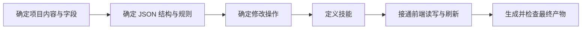

# 项目 JSON 与技能协作流程

记录日期：2026-10-24

本文记录已经讨论确定的方向和后续顺序。具体字段、JSON 结构和技能接口还需要逐项梳理，本文不代表这些功能已经实现。

## 目标

用一份完整的项目 JSON 作为统一的数据来源，保存项目设置、模块设计和画布布局。

用户在已有的 Agent 中调用技能，修改 JSON 中指定的内容；网页重新读取数据并显示结果。网页中的手动编辑也保存到同一份项目 JSON，最终产物从这份数据生成。

软件不负责安装、扫描、启动或管理电脑上的 Agent。

## 当前基础

现有项目已经有集中管理的项目数据结构，包括项目、层级、模块、功能需求、属性、方法、事件、测试和连线等内容。

当前项目数据位于技能包内的 `tools/archify.json`，新建项目的默认数据模板位于 `tools/html/templates/archifytemplate.json`。网页工程位于 `tools/html/`，生成的运行页是 `tools/html/index.html`。网页编辑后的数据仍保存到 HTML 的 `ec-project` 数据块，再通过 html2archify 提取回 JSON；独立 JSON 的持续读写与自动刷新尚未接通。

接下来需要围绕独立的项目 JSON，明确字段、修改规则、前端读写和产物生成方式。已有字段和校验逻辑作为梳理基础。

## 推进顺序

| 步骤 | 要确定的内容 | 完成后得到什么 |
|---|---|---|
| 1. 确定项目内容 | 按项目、层级、模块及模块内部内容，逐项确定需要保存的参数及含义 | 字段清单，区分必需内容和可选内容 |
| 2. 确定 JSON 结构 | 字段名、类型、必填项、默认值、层级关系、稳定 ID 和引用规则 | 一份可校验的数据规范和完整示例 |
| 3. 确定修改操作 | 新增、修改、删除如何定位对象，修改范围如何限制，关联数据如何处理 | 前端和技能共同遵守的修改规则 |
| 4. 定义技能 | 按任务划分技能，明确输入、可修改范围、执行步骤和返回结果 | 若干职责清楚的技能及调用示例 |
| 5. 接通前端 | 打开、编辑、保存同一份 JSON，重新读取外部修改，处理尚未保存的编辑 | 网页与技能修改的数据可以一致显示和保存 |
| 6. 生成产物 | 明确输出种类、生成方式、更新范围和检查方法 | 由同一份 JSON 生成的网页、设计文档及后续确定的其他产物 |

JSON 规范定义数据的内容和结构；修改操作定义怎样安全地改变这些数据；技能组织这些操作完成用户的任务。

## 各部分的职责

| 部分 | 职责 |
|---|---|
| 项目 JSON | 保存项目的完整设计数据，作为网页和产物生成的统一依据 |
| 已有 Agent | 接收用户要求，调用技能并执行修改 |
| 技能 | 读取相关对象，按约定修改指定内容，检查并保存，说明修改结果 |
| 网页 | 展示、编辑和保存项目数据，重新读取技能保存的变化 |
| 产物生成工具 | 根据同一份数据生成指定产物，并检查结果 |

已确定一个总入口和四个子技能：总入口 easycode-archify 规划任务，按顺序调用 easycode-archify-code2archify、easycode-archify-archify2html、easycode-archify-html2archify、easycode-archify-translate。分别负责源码转架构数据、架构数据转网页、网页取回架构数据、指定对象的英文命名。

## 数据与修改规则

| 规则 | 说明 |
|---|---|
| 统一数据来源 | 网页编辑、技能修改和产物生成使用同一份项目 JSON |
| 使用稳定 ID | 对象重命名后 ID 不变；模块关系通过 ID 关联，避免重名造成误改 |
| 限定修改范围 | 只修改用户指定的对象与字段，保留无关内容、标识和布局 |
| 处理关联关系 | 删除对象前明确处理其连线或引用，不能留下失效引用 |
| 检查后保存 | 修改后的字段类型、必填内容、ID 和引用通过检查后，才替换项目文件；失败时保留原数据 |
| 区分两种版本 | 数据格式版本描述 JSON 结构，代码版本描述项目代码，分别保存 |
| 处理同时修改 | 技能保存时检查文件是否已被别人修改；前端刷新时处理未保存编辑，避免直接覆盖 |
| 保留来源含义 | 来自源码核对的内容被修改后，按现有规则标记为待核对 |

## 一次修改的例子

用户要求：把任务模块里的“保存任务”方法翻译成英文名，并更新网页。

| 步骤 | 行为 |
|---|---|
| 1 | 总技能确认当前输入；若从编辑后的网页继续，先由 html2archify 取回保存的数据 |
| 2 | translate 根据模块和稳定 ID 定位“保存任务”方法，给出英文名变化清单 |
| 3 | 在确认的范围内更新英文名，检查并保存 tools/archify.json |
| 4 | archify2html 根据这份 JSON 生成 tools/html/index.html，并读回核对 |
| 5 | 用户打开更新后的运行页查看结果 |

## 接下来梳理的内容

| 顺序 | 梳理范围 |
|---|---|
| 1 | 项目级参数：名称、描述、代码目录、代码版本等 |
| 2 | 层级与模块参数：名称、语言、职责、相对路径、归属等 |
| 3 | 模块内部内容：功能需求、属性、方法、输入输出、事件、测试等 |
| 4 | 连线、布局、源码出处及待确认内容 |
| 5 | JSON 示例、校验规则、修改操作与技能边界 |

项目数据与默认模板的位置已经确定。尚需决定：网页自动更新还是手动刷新、同时修改时的处理方式，以及最终产物的具体范围。代码文件是否生成、如何生成，留到产物范围讨论时确定。

每轮先确认字段与规则，再进行对应实现。既有设计背景见 [EasyCode Archify 设计文档](superpowers/specs/2026-10-23-easycode-archify-design.md)。
